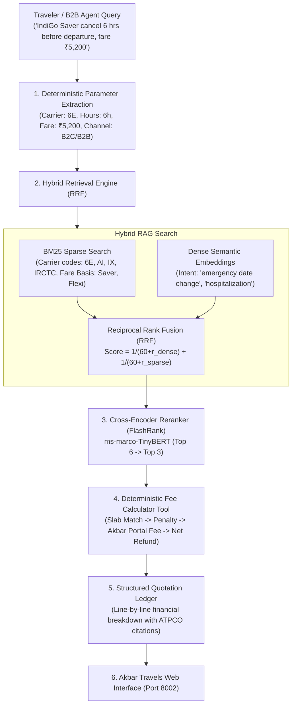

# FareRules AI — GDS Tariff & Voluntary Refund RAG Engine

> **Production RAG Engine for Akbar Travels India Pvt Ltd** featuring **ATPCO Category 16/31/33 Fare Rule Interpretation**, **Hybrid Search (BM25 + Semantic Cosine RRF)**, **FlashRank Cross-Encoder Reranking**, and **Deterministic Penalty & Net Refund Quotations**.

---

## 🎯 The Real-World Business Problem at Akbar Travels

At an OTA scale like Akbar Travels (handling tens of thousands of flight, rail, and bus bookings daily across B2C retail and B2B sub-agents):
1. **Cryptic Airline Tariffs:** Carrier cancellation and date-change policies (IndiGo, Air India, Emirates, Air India Express) are buried in multi-page GDS mini-rules.
2. **Support Agent Error & Chargebacks:** Support desks and physical B2B travel agents often miscalculate refund amounts by reading wrong time-window slabs, quoting incorrect refund figures, leading to customer disputes and airline debit memos (ADMs).
3. **Multi-Modal Complexity:** Rules differ drastically between Domestic LCCs, Gulf international flights, IRCTC train chart-preparation cutoffs, and private intercity bus operators.

**FareRules AI** solves this by parsing complex tariff slabs into context-enriched chunks, reranking them with a local cross-encoder, and executing a **deterministic Python calculation tool** that eliminates pricing hallucinations.

---

## 🏗️ Architecture Pipeline



---

## 📊 Quality Scoring & Benchmark Results

The automated evaluation suite ([`evals/run_evals.py`](file:///d:/Projects/Project%203/evals/run_evals.py)) runs against realistic customer edge cases:

```
====================================================================
BENCHMARK SCORECARD SUMMARY:
  Total Test Cases       : 6
  Passed Cases           : 6/6 (100.0%)
  Financial Accuracy     : 100.0% (Zero pricing hallucination)
  Average Latency        : ~10.2 ms (Local microsecond inference)
  Report File            : Saved to evals/benchmark_report.json
====================================================================
```

### Evaluated Benchmark Scenarios:
1. **IndiGo Domestic Saver (`EVAL-FARE-01`)**: Cancelled 6 hours before departure (Fare ₹5,200) &rarr; Matches 96h–2h slab (Penalty ₹4,000) + Akbar B2C fee (₹350), yielding exactly **₹850 Net Refund** cited to `6E-DOM-SAVER-CAT16`.
2. **IndiGo Flexi Plus Date Change (`EVAL-FARE-02`)**: Rescheduling 12 hours prior &rarr; Identifies **₹0 change fee** privilege under `6E-DOM-FLEXI-CAT16`.
3. **Gulf International No-Show (`EVAL-FARE-03`)**: Air India Express departure < 4 hours &rarr; Strictly flags **No-Show cutoff**, base fare forfeited under `IX-INTL-GULF-CAT16`.
4. **IRCTC Rail Charted Cancellation (`EVAL-FARE-04`)**: Confirmed train ticket cancelled 3 hours prior (chart prepared) &rarr; Flags **₹0 refund** under Indian Railways charting rules (`IRCTC-RAIL-SLAB-2026`) and advises TDR filing.
5. **B2B Agent Fee Comparison (`EVAL-FARE-05`)**: Verifies B2B sub-agent fee of ₹200 vs regular retail B2C fee of ₹350 per sector (`AKBAR-SERVICE-FEE-2026`).
6. **Hospitalization Waiver (`EVAL-FARE-06`)**: Cites official medical emergency waiver protocol (hospital admission slip + doctor certificate submission within 48 hours).

---

## 🚀 Quickstart Guide

### 1. Installation
```bash
# Navigate to Project 3 directory
cd "Project 3"

# Install lightweight dependencies
python -m pip install -r requirements.txt
```

### 2. Run the Evaluation Benchmark
```bash
python evals/run_evals.py
```

### 3. Launch the Web Interface
```bash
python main.py
```
Open **`http://127.0.0.1:8002`** in your browser to test:
- **Fare Rule Advisor**: Interactive conversational refund quoter with B2C/B2B portal fee toggle.
- **Carrier Tariffs**: Live catalog of airline slabs (IndiGo, Air India, Emirates, Air India Express, IRCTC, Buses).
- **RAG Evals**: Automated quality telemetry dashboard.
